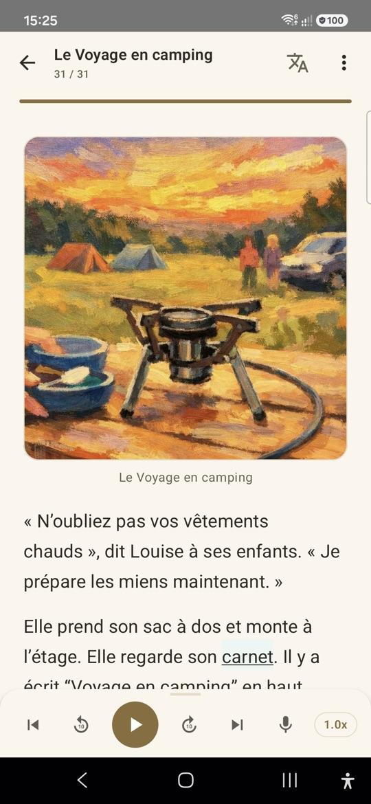
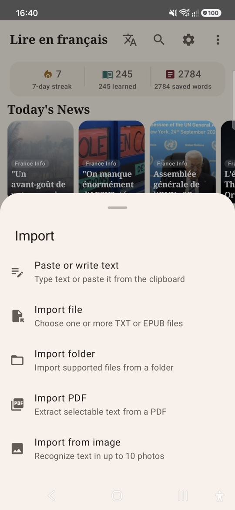
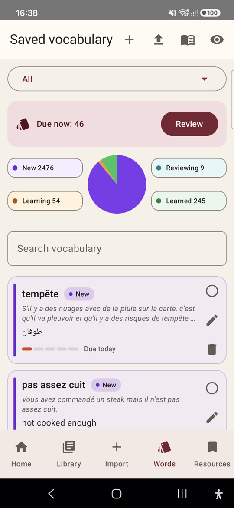
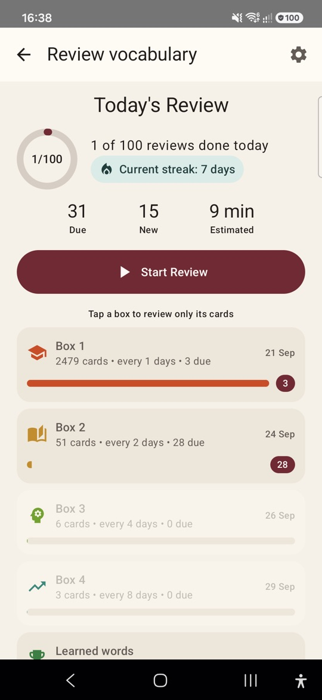
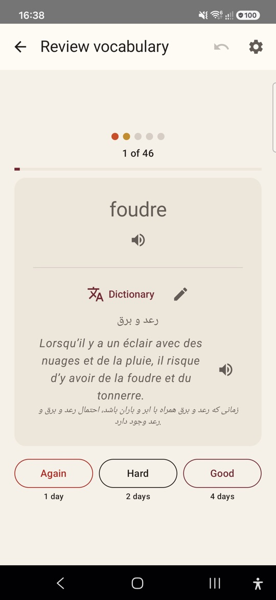

  <a href="README.md">English</a> · <b>فارسی</b>

# French Reader

اپلیکیشن اندروید برای یادگیری زبان فرانسه با خواندن: متن‌های واقعی فرانسوی را بخوانید، به آن‌ها گوش دهید، معنی کلمه‌ها را پیدا کنید و کلمه‌های ذخیره‌شده را مرور کنید.

## ⬇️ دانلود

  
  

۱. روی گوشی اندرویدتان دکمهٔ **Download** بالا را بزنید. همیشه جدیدترین نسخه دانلود می‌شود.

۲. فایل دانلودشدهٔ **FrenchReader.apk** را باز کنید (از اعلان‌ها یا پوشهٔ **Downloads**).

۳. اگر اندروید اجازه خواست، نصب برنامه از مرورگر یا فایل‌منیجر را مجاز کنید و بعد **Install** را بزنید.

به اندروید ۸ یا جدیدتر نیاز دارد. برای به‌روزرسانی، کافی است دوباره دانلود و نصب کنید؛ کلمه‌ها و متن‌هایتان حفظ می‌شوند.

همچنین می‌توانید برنامه را از [کافه‌بازار](https://cafebazaar.ir/app/com.ziaee.frenchreader) نصب و به‌روزرسانی کنید.

نسخه‌های قبلی در [صفحهٔ Releases](https://github.com/Ziaeemehr/FrenchReaderSpike/releases) هستند.

## تصاویر

  
  
  

  
  
  

## ویژگی‌ها

- **خواندن** متن‌های فرانسوی. کلمه‌های ذخیره‌شده بر اساس میزان یادگیری رنگ می‌گیرند. می‌توانید بخش‌هایی از متن را با رنگ دلخواه هایلایت کنید، ترجمهٔ هر پاراگراف را ببینید، در متن‌های بلند با فهرست مطالب جابه‌جا شوید و داخل متن جستجو کنید.
- **شنیدن** متن با صدای طبیعی و سرعت دلخواه؛ هر جمله هنگام خوانده شدن مشخص می‌شود و صفحه همراه آن جلو می‌رود.
- **شدوینگ (Shadowing)**: یک جمله را بشنوید، دکمه را نگه دارید و آن را تکرار کنید. برنامه بررسی می‌کند چند کلمه را درست گفتید و سرعت‌تان چطور بود، و در پایان خلاصه‌ای نشان می‌دهد. بدون اینترنت یا با تشخیص گفتار اندروید کار می‌کند.
- **پیدا کردن معنی** هر کلمه با یک لمس؛ برای انتخاب یا هایلایت یک عبارت، لمس طولانی کنید و آن را همراه با جمله‌اش ذخیره کنید.
- **مرور** کلمه‌ها با فلش‌کارت و تکرار فاصله‌دار (جعبهٔ لایتنر)، با صدای هر کارت، هدف روزانه و یادآور.
- **دسته‌بندی کلمه‌ها** در دک‌ها: چند کلمه را با هم انتخاب کنید و جابه‌جا یا حذف کنید، با لمس هر کلمه کارتش را ببینید، یا کلمه‌ها را از Anki یا از یک فایل جدول وارد کنید (CSV با ستون‌های کلمه، معنی، جمله، دک؛ فایل نمونه داخل برنامه هست).
- **کتابخانه** با پوشه و برچسب. جستجو داخل خود متن‌ها هم انجام می‌شود (بدون حساسیت به اعراب فرانسوی) و متن را در همان قسمت باز می‌کند. برای هر متن نشان داده می‌شود چند درصد کلمه‌هایش را بلدید.
- **افزودن متن** از هر جا: چسباندن، فایل TXT/Markdown/EPUB، یک پوشهٔ کامل (همراه با عکس‌ها)، ‏PDF، عکس (تشخیص متن)، یا اشتراک‌گذاری از اپ‌های دیگر.
- **محتوای آماده**: اخبار روزانهٔ فرانسوی، داستان‌های سطح‌بندی‌شده و مجموعه‌های واژگان.
- **آمار**: روزهای پیاپی مطالعه، زمان شنیدن، فعالیت و دقت مرور، امتیاز شدوینگ، و تعداد متن‌ها و کلمه‌های ذخیره‌شده.
- **پشتیبان‌گیری** روی گوشی یا Google Drive.
- زبان برنامه: انگلیسی، فرانسوی یا فارسی.

## تولید صدای محلی (اختیاری)

می‌توانید سرور XTTS را روی کامپیوترتان اجرا کنید و برنامه را به آن وصل کنید. مراحل نصب، اجرای سرور و اتصال از طریق Wi-Fi یا USB در [راهنمای راه‌اندازی XTTS](tools/xtts_server/README.md) آمده است.

## ⭐ حمایت

اگر French Reader در یادگیری فرانسه به شما کمک کرده، لطفاً در گیت‌هاب به آن ستاره بدهید؛ رایگان است و کمک می‌کند زبان‌آموزان دیگر هم برنامه را پیدا کنند.

## حریم خصوصی

[سیاست حریم خصوصی](PRIVACY.md) را ببینید.

